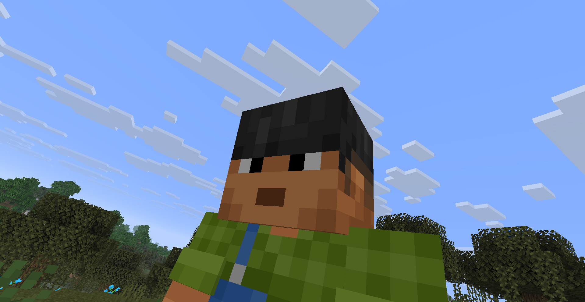

# Free Camera

Free Camera 3.0.0 is a client-side Minecraft camera mod for Minecraft 26.1.2 and 26.2 on Fabric, Forge, and NeoForge. It provides detached camera modes, cinematic controls, recording, and camera paths without moving the real player or manipulating movement packets.



## Features

- Free Camera with accelerated six-axis movement and five speed presets
- Orbit, Tripod, and Follow camera modes
- Chase, Side, Fixed Angle, and Look At follow profiles
- Responsive and Cinematic motion profiles
- Continuous camera roll and smooth hold-to-zoom
- OFF, SOFT, and VANILLA-style camera collision
- Fixed-rate camera recording and time-based playback
- Keyframe paths with easing, holds, looping, reverse, and ping-pong playback
- Built-in six-tab settings and Camera Studio screens
- Configurable status overlay, hand, crosshair, HUD, view bobbing, hurt shake, and letterbox
- Versioned JSON configuration, recordings, and paths with validation and corruption recovery

## Controls

| Control | Action |
| --- | --- |
| **F6 short press** | Activate the preferred or last-used camera mode; press again to deactivate |
| **Hold F6 for 0.30 seconds** | Open the Free / Orbit / Tripod / Follow radial menu |
| **F9** | Toggle Cinematic motion |
| **F10** | Open Free Camera Settings |
| **G** | Select a loaded entity near the center of the view while Follow is active |
| **Z / C** | Roll continuously |
| **V** | Hold smooth zoom; the default multiplier is 3× |
| **R** | Reset roll, then reset the active camera mode when already upright |
| **Mouse wheel** | Change Free Camera speed, Orbit radius, or Follow distance |

Direct Free, Orbit, and Tripod shortcuts are available in Minecraft Controls and are unbound by default. Recording and last-recording playback shortcuts are also available but unbound by default. Every camera key can be rebound.

## Camera modes

### Free

Move independently with camera-relative WASD, Space, and Shift controls. Movement is time-based, accelerates smoothly, normalizes diagonal input, and never moves the real player.

### Orbit

Orbit around the local player with an independently requested radius. Collision can retract the rendered camera around obstructions and smoothly restore the requested radius when clear.

### Tripod

Capture and hold an exact visible camera pose. Tripod remains fixed until reset, switched, or deactivated.

### Follow

Follow the local player or a selected loaded player, mob, armor stand, boat, minecart, or vehicle. Chase, Side, Fixed Angle, and Look At profiles are available. If the target disappears, the visible pose is preserved and the session safely switches to Free Camera.

## Cinematic motion, roll, zoom, and collision

Cinematic motion provides smoother acceleration, deceleration, rotation, roll, and zoom without changing the real player. Roll rotates the world view while keeping the GUI upright and supports continuous full rotations. Zoom changes only the detached world projection and does not alter Minecraft's global FOV option.

Collision is configurable separately for Free, Orbit, Follow, and playback. It uses already-loaded client block collision shapes and never forces chunk loading. Liquids and non-collidable plants are ignored. At unloaded chunk boundaries, enabled collision preserves the last safe visible position until collision data is available.

## Recording, playback, and paths

Camera recording stores the final visible detached-camera pose at a fixed time-based sample rate. The default is 30 samples per second with a ten-minute limit; settings allow 10–120 samples per second and bounded storage limits.

Camera Studio supports recording, stopping, saving, renaming, duplicating, deleting, looping, reverse playback, playback speed, and optional playback collision. Saved tracks preserve position, yaw, pitch, continuous roll, and zoom.

Keyframes store position, rotation, roll, zoom, duration, hold duration, and easing. Paths support linear or smooth position interpolation, Linear/Smooth/Cinematic easing, loop, reverse, ping-pong, and adjustable playback speed.

## Settings and storage

Press F10 to open the built-in General, Camera, Follow, Visuals, Studio, and Advanced tabs. The settings screen supports Apply, Cancel, Done, tab reset, full reset, preset previews, scrolling, keyboard focus, validation, and unsaved-change tracking. Fabric builds also support the optional Mod Menu Configure button.

- Main configuration: `config/free-camera.json`
- Saved recordings: `config/free-camera/recordings/`
- Saved paths: `config/free-camera/paths/`

Configuration and track files use bounded, versioned JSON. Saves use temporary files and atomic replacement where supported. Corrupt files are reported and preserved or backed up instead of being silently deleted.

## Supported versions

All current builds require Java 25 and are client-side only.

| Source folder | Loader version | Minecraft | Mod |
| --- | --- | --- | --- |
| [`3.0/`](3.0/) | Fabric Loader 0.18.5+, Fabric API 0.145.4+26.1.2 | 26.1.2 | 3.0.0 |
| [`3.0-26.2/`](3.0-26.2/) | Fabric Loader 0.19.3+, Fabric API 0.154.2+26.2 | 26.2 | 3.0.0 |
| [`forge-26.1.2-3.0/`](forge-26.1.2-3.0/) | Forge 64.0.12+ | 26.1.2 | 3.0.0 |
| [`forge-26.2-3.0/`](forge-26.2-3.0/) | Forge 65.0.6+ | 26.2 | 3.0.0 |
| [`neoforge-26.1.2-3.0/`](neoforge-26.1.2-3.0/) | NeoForge 26.1.2.84+ | 26.1.2 | 3.0.0 |
| [`neoforge-26.2-3.0/`](neoforge-26.2-3.0/) | NeoForge 26.2.0.28-beta+ | 26.2 | 3.0.0 |

## Installation

1. Install Minecraft 26.1.2 or 26.2.
2. Install a compatible Fabric, Forge, or NeoForge version from the table above.
3. Fabric users must also install the matching Fabric API.
4. Download the JAR matching both the Minecraft version and loader.
5. Place the JAR in the Minecraft `mods` folder and launch the matching profile.
6. Enter a world and press F6.

The mod normally does not need to be installed on the server.

## Building

Each source folder is an independent Gradle project with its own wrapper, properties, metadata, and source tree. Choose one current project folder from the supported-versions table.

Windows PowerShell:

```powershell
cd <project-folder>
$env:JAVA_HOME = 'path-to-jdk-25'
.\gradlew.bat clean check build
```

Linux or macOS:

```bash
cd <project-folder>
JAVA_HOME=/path/to/jdk-25 ./gradlew clean check build
```

Successful builds place the distributable and sources JARs in `<project-folder>/build/libs/`. The build runs automated motion, camera-mode, cinematic, roll, zoom, collision, recording, storage, Follow, lifecycle, and Minecraft render-pipeline checks.

## Legacy source archives

The following folders contain historical Free Camera 2.2.0 implementations:

| Folder | Loader | Minecraft |
| --- | --- | --- |
| [`fabric-1.20.1/`](fabric-1.20.1/) | Fabric | 1.20.1 |
| [`fabric-1.21.1/`](fabric-1.21.1/) | Fabric | 1.21.1 |
| [`fabric-1.21.4/`](fabric-1.21.4/) | Fabric | 1.21.4 |
| [`forge-1.20.1/`](forge-1.20.1/) | Forge | 1.20.1 |
| [`forge-1.21.1/`](forge-1.21.1/) | Forge | 1.21.1 |
| [`forge-1.21.4/`](forge-1.21.4/) | Forge | 1.21.4 |
| [`neoforge-1.21.1/`](neoforge-1.21.1/) | NeoForge | 1.21.1 |
| [`neoforge-1.21.4/`](neoforge-1.21.4/) | NeoForge | 1.21.4 |

## Safety and privacy

Free Camera does not write player position, velocity, rotation, physics, bounding box, or `noPhysics`; modify entities; change key states; send or cancel packets; or force chunk loading. Gravity, vehicles, water, knockback, damage, and server movement continue to affect the real player normally.

The mod does not transmit camera paths, recordings, configuration, or detached-camera movement. These files remain in the local Minecraft configuration directory unless the user copies them elsewhere.

## Troubleshooting

- If older options retain conflicting Z/C bindings, rebind or reset those controls in Minecraft Controls.
- If `free-camera.json` is corrupt, it is renamed with a `.corrupt` suffix and safe defaults are restored.
- If a configured key conflicts with another mod, change it through Minecraft Controls.
- At unloaded chunk boundaries, enabled collision waits for already-available client data instead of requesting chunks.

## License

Free Camera is available under the MIT License. See [`LICENSE`](LICENSE).
